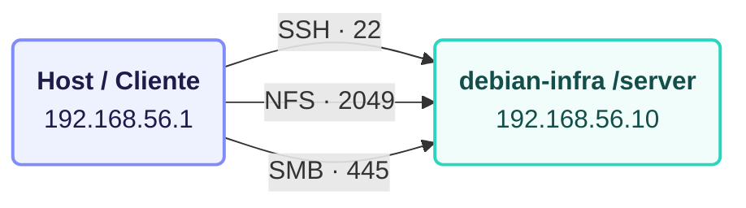

# Debian-infraestructure-homelab
Homelab de infraestructura en Debian: almacenamiento, hardening, servicios de red

# 🐧 Debian Infrastructure Homelab (Portafolio de Infraestructura)

Este repositorio documenta la construcción paso a paso de un entorno de infraestructura local basado en **Debian 12 (Bookworm)**, diseñado para simular servicios corporativos de almacenamiento, accesos seguros, endurecimiento de sistemas (hardening) y observabilidad.

## 🏗️ 1. Topología y Arquitectura del Lab

El entorno está desplegado sobre un hipervisor local (VirtualBox) utilizando máquinas virtuales interconectadas mediante red interna / Host-Only:

- **Hipervisor:** VirtualBox
- **Sistema Operativo Base:** Debian 12 (Bookworm) - Versión Minimal Netinst
- **VM Principal (`debian-infra`):** 
  - IP Estática: `192.168.56.10`
  - Propósito: Alojamiento de servicios de red, almacenamiento (NFS/Samba) y SFTP seguro.
- **VM Cliente (`debian-client`):**
  - IP Estática: `192.168.56.11`
  - Propósito: Validación de accesos, montajes de red y pruebas de aislamiento de usuarios.

## 💾 2. Diseño de Particionado y Almacenamiento

Para garantizar estabilidad, rendimiento y evitar que un desbordamiento de logs sature el sistema operativo, se implementó el siguiente esquema de particionamiento lógico durante la instalación:

- **`/` (Root):** Partición principal dedicada al sistema operativo y binarios base.
- **`/var`:** Separada para contener logs dinámicos y bases de datos, aislando el espacio del sistema.
- **`/home` y Directorios de Datos (`/srv`):** Espacios dedicados para puntos de montaje, recursos compartidos y jaulas de usuario.
- **`swap`:** Memoria de intercambio optimizada para la máquina virtual.

---

## 📂 3. Estructura del Repositorio

El proyecto se encuentra modularizado para facilitar la lectura y demostrar buenas prácticas de documentación de infraestructura:

- **[Módulo 01: Instalación y Hardening Base](./01-base-hardening-setup/)** -> Configuración inicial, particionado, actualización de paquetes, reglas de firewall (UFW) y endurecimiento de SSH.
- **[Módulo 02: Almacenamiento en Red (NFS y Samba)](./02-nfs-samba-storage/)** -> Compartición de recursos y archivos en red local.
- **[Módulo 03: Servidor SFTP Seguro con Chroot](./03-sftp-secure-chroot/)** -> Aislamiento de usuarios, llaves SSH centralizadas y resolución de incidencias (troubleshooting).

*Autor: Herpa23 | Perfil enfocado en Infraestructura IT, SysAdmin y Cloud.*